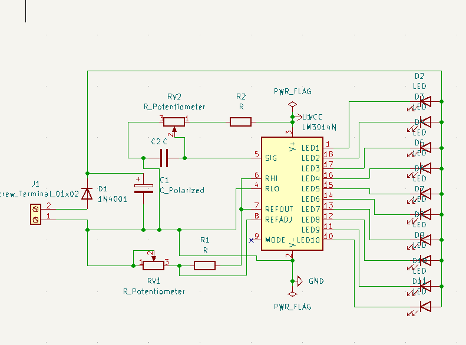
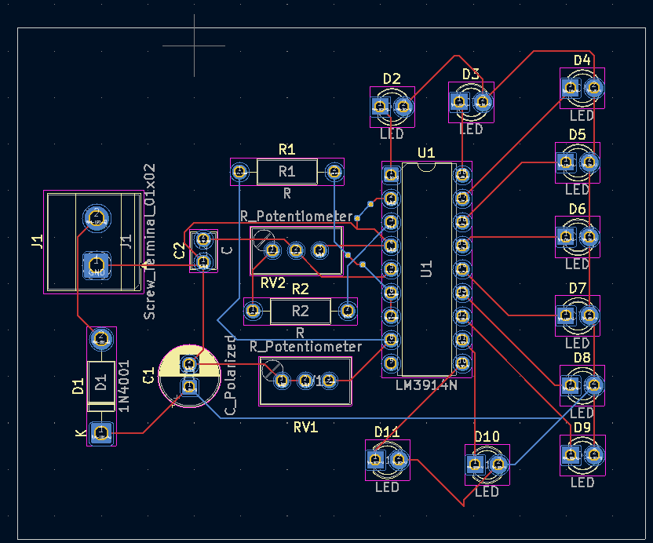

# Battery Level Indicator using KiCad

## Description
This project implements a battery level indicator circuit and PCB design using KiCad.

## Working
1. The circuit is designed to indicate the battery level.
2. The schematic shows the electrical connections between components.
3. The PCB layout shows component placement and copper routing.
4. The 3D model provides a visual representation of the PCB.

## Tools Used
- KiCad
- KiCad Schematic Editor
- KiCad PCB Editor
- KiCad 3D Viewer

## Files
- `batterylevelindicator.kicad_sch` : Schematic design
- `batterylevelindicator.kicad_pcb` : PCB design
- `schematic.png` : Schematic image
- `pcb.png` : PCB layout image
- `3D Model.png` : 3D PCB model

## Schematic

## PCB Layout

## 3D Model

## Result
The battery level indicator schematic and PCB layout were designed using KiCad. The 3D model helps visualize the board before manufacturing.

## Author
Vijay Kumar
